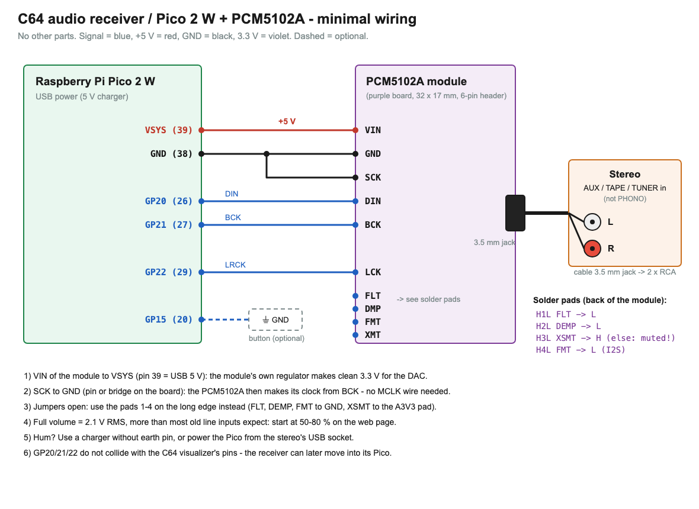
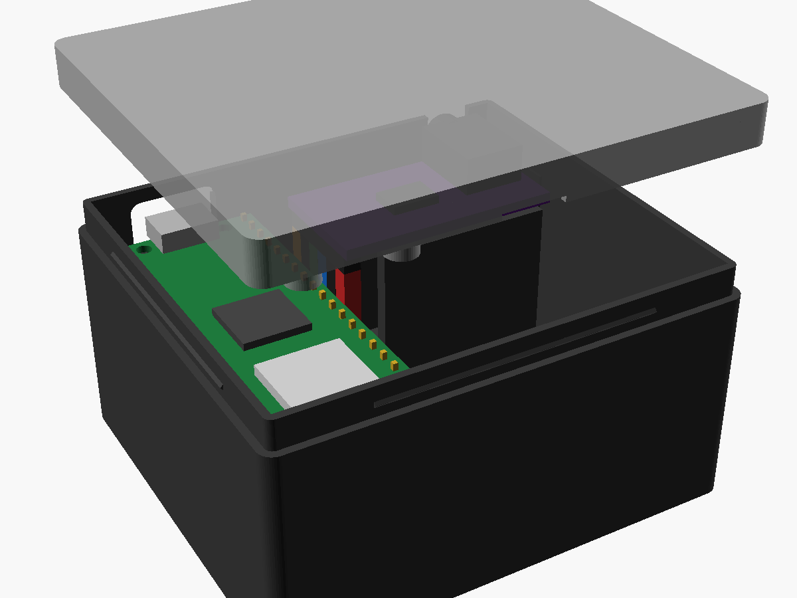
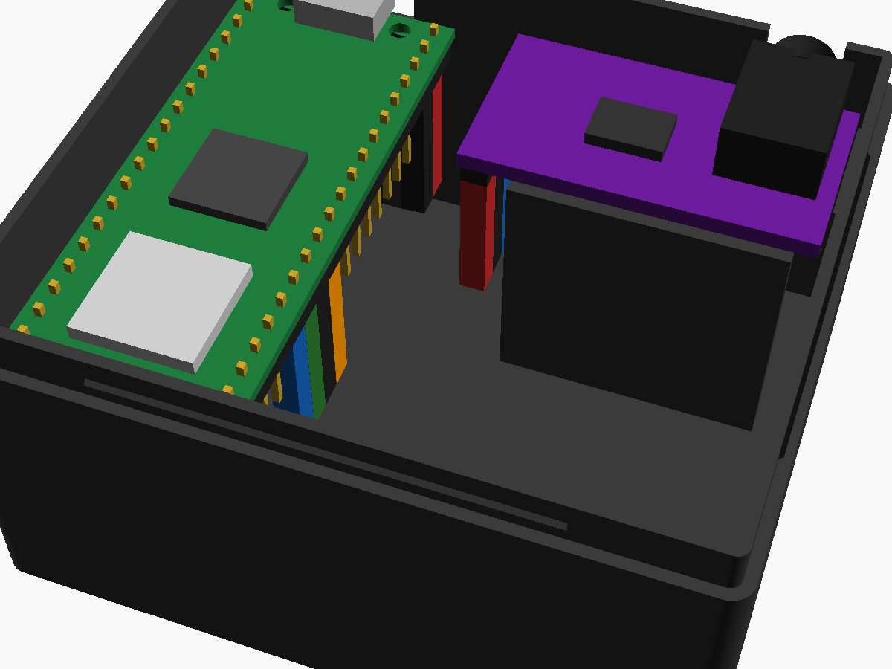
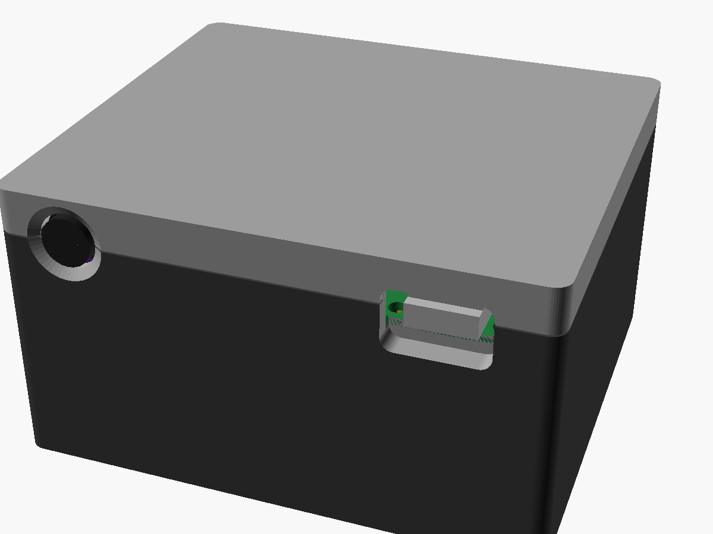

# C64 audio receiver – Pico 2 W + PCM5102A

*Deutsche Version: [README_DE.md](README_DE.md)*

**User manual (German):** [docs/HANDBUCH.md](docs/HANDBUCH.md) – setup, wiring, web page, forwarding, backup, update,
WLAN behaviour, troubleshooting and diagnostics lines. The same manual is the **Hilfe** tab of the web page.

Receives the **audio stream of an Ultimate 64 (Elite II)** over WLAN and plays it through a **PCM5102A I2S DAC module**
into the RCA inputs of a stereo – true stereo, 48 kHz, no cable from the C64 to the stereo.
At the same time it forwards the stream to the **C64 visualizer** (the Ultimate streams to one receiver only).

- **Jitter buffer** by sequence number (target 80 ms, 40–300 ms): packets out of order or twice do no harm
- **Clock matching without resampling:** the I2S clock itself follows the Ultimate (PI control of the dithered PIO divider) –
  the Ultimate runs at ~47 983 Hz, not 48 000 Hz
- **Drop-outs are hidden instead of clicking:** missing packets are bridged by playing the previous one again, mirrored in
  time (up to 12 ms, fading), then silence with smooth fades
- **Forwarding** of every packet, unchanged, to the visualizer (can be switched off; target as IP or name, e.g. `c64viz.local`)
- **"Stream comes forwarded"**: when another device (e.g. the Raspberry Pi jukebox) fetches the stream and passes it on,
  the receiver never asks the Ultimate itself – otherwise it would take the stream away whenever that device stalls
- **Several Ultimates** (up to 4) – choose the source on the web page or with the button; network search for Ultimates
- **Devices in the network:** beacons every 10 s (UDP broadcast, port 11064, same format as the visualizer); the card
  "Geräte im Netz" shows every visualizer and receiver and the way of the sound
- **Setup assistant of the visualizer:** it opens this page as `http://<ip>/#setup=<json>` with forwarding and Ultimate
  filled in (yellow outline, banner); saving also makes that Ultimate the source and switches playing on
- **Web page (German)** with Digest login: start/stop, source, volume, live buffer/losses/clock deviation, WLAN and Ultimate
  settings, backup of the settings as a file, firmware update over WLAN, diagnostics log, built-in manual (tab **Hilfe**:
  kept gzip-compressed in flash, `GET /hilfe`, about 11 KB, loaded only when the tab is opened; "? Hilfe zu diesem Tab"
  in every other tab jumps to the matching section)
- Device name / mDNS as on the visualizer: **http://c64audio.local**

> **Guide for all three devices together** (visualizer, audio receiver, Raspberry Pi jukebox – setup, chaining,
> operation, illustrated): [docs/Guide_C64-Ecosystem.pdf](docs/Guide_C64-Ecosystem.pdf) – German version:
> [docs/Anleitung_C64-Oekosystem.pdf](docs/Anleitung_C64-Oekosystem.pdf)

## What was tested – and what was not

| Tested | Not tested yet |
|---|---|
| Firmware builds for the Pico 2 W (Pico SDK 2.1.1); **on a real PCM5102A:** sound on headphones and the stereo, sounds good (wired as in the schematic) | Level and I2S timing with a measuring device (oscilloscope/logic analyser) |
| Packet format measured on a real Ultimate 64 Elite II (sequence little endian, 192 frames, 47 982 Hz) | CPU load of the timer interrupt |
| **On a real Pico 2 W with the Elite II:** reception 250 packets/s without loss, buffer 82–84 ms, clock locks at 47 982.6–47 983.0 Hz; forwarding to a Mac 7 997 packets in 32 s complete and in order, to the visualizer (`c64viz.local`, resolved by mDNS) 250 packets/s, taken over without a gap, the visualizer does not ask for the stream again; start requests the stream, stop ends it; saving the volume while playing without drop-outs; firmware update over WLAN (393 KB in 4.6 s) | |
| Host tests: jitter buffer sample by sample, the whole chain simulated 4 × 10 min, network part with fakes; web page in a browser (Playwright) | |

## Wiring



| Pico 2 W | PCM5102A module |
|---|---|
| VSYS (pin 39) | VIN (5 V, the module has its own 3.3 V regulator) |
| GND (pin 38) | GND **and SCK** |
| GP20 (pin 26) | DIN |
| GP21 (pin 27) | BCK |
| GP22 (pin 29) | LCK |
| GP15 (pin 20) – optional | button to GND |

**The PCM5102A module** (purple board 32 × 17 mm with a 3.5 mm jack and a 6-pin header SCK, BCK, DIN, LCK, GND, VIN, 3.3–5.5 V)
has four solder pads on the back that
often come **open** – the module then stays muted:

| Pad | Function | Setting |
|---|---|---|
| H1L | FLT (filter) | L |
| H2L | DEMP (de-emphasis) | L |
| H3L | XSMT (soft mute) | **H** (else muted!) |
| H4L | FMT (format) | L = I2S |

With open pads, use the pads 1–4 on the long edge instead (FLT, DEMP, XSMT, FMT): FLT, DEMP, FMT to GND, XSMT to the A3V3 pad.
**SCK to GND** (pin or the bridge next to SCK on the front): the PCM5102A then derives its clock from BCK.

Other boards (e.g. the small 6-pin one with VIN/GND/LCK/DIN/BCK/SCK) are wired the same way; without an on-board regulator,
connect VIN to **3V3 OUT (pin 36)** instead of VSYS.

**To the stereo:** cable 3.5 mm jack → 2 × RCA into **AUX / TAPE / TUNER / CD** (not PHONO). At full volume the PCM5102A
gives 2.1 V RMS – more than old line inputs usually expect. Start at 50–80 % on the web page (default 80 % ≈ −4 dB).
If it hums, use a charger without earth pin or power the Pico from the stereo's USB socket.

GP20/21/22 do not collide with the visualizer (GP4/5, GP14–19, GP26/27) – the receiver can later move into its Pico.

## Case





`case/receiver_case.scad` – base and slip-on lid like the visualizer's light sensor case (skirt over the thinner upper
walls, snap bead, finger notch), outside **64 × 57 × 35 mm**. Pico and PCM module lie side by side, both headers soldered
**pointing down**, with a cable room for the DuPont plugs below them (the wires bend there; 10 cm wires are fine).
**USB socket and jack both face the back.**

- The Pico rests on a ledge on the back wall and on two pegs through its front mounting holes; the module on a ledge on the
  back wall and a rib along its front edge.
- The jack opening in the base is a slot open to the top, so the module drops in with its jack sticking out; a tongue on
  the lid closes it to a round hole. Press posts in the lid hold both boards down (on the Pico's holes, its USB socket and
  the top of the jack).
- Assembly: plug the 6 wires on first, then put in Pico and module, press the lid on.
- Printing: `case/receiver_base.stl` upright, `case/receiver_lid.stl` (already turned over) top face down, no supports.
  Four recesses in the floor for 8 mm rubber feet. STEP for Fusion: `case/step/` (`receiver_case_to_step.py`).
- **The PCM module's dimensions are from the seller's drawing** – measure yours and adjust the values marked (!) at the top
  of `receiver_case.scad` (mainly `jack_u`, `jack_d`, `jack_z`, `jack_over`), then export again.

## Firmware

| File | Purpose |
|---|---|
| `firmware/c64audio.uf2` | normal firmware |
| `firmware/c64audio_debug.uf2` | also diagnostics on USB serial (`screen /dev/tty.usbmodem* 115200`) |
| `firmware/wlan_reset.uf2` | clears the WLAN / Ultimate / password settings (same file as the visualizer's) |

Flashing: hold BOOTSEL (or the button on GP15) while plugging in and copy the .uf2 to the drive – or
`picotool load -f firmware/c64audio.uf2 && picotool reboot`. Later it works over the web page (tab **System**).

If the Pico ran the visualizer firmware before, the receiver takes over its WLAN, web password and Ultimate.

## Getting started

1. Plug in the Pico. Without settings it opens the access point **C64-Audio** (password `commodore64`).
   Connect and open **http://192.168.4.1**. With a home WLAN set, it opens the access point only when the WLAN password
   is wrong or three attempts fail (WLAN not found, no address from the router); from there it tries again every
   5 minutes. If it was in the home WLAN since switching on, it only reconnects after an outage, without access point.
2. Under **Einstellungen**: WLAN name and password, the Ultimate's address (IP or name) and its network password if set –
   or **"Netzwerk nach Ultimates durchsuchen"** and put a hit into the next free row with **"übernehmen"**. The search asks
   every address of the home network for `/v1/info`, takes a little over a minute (the sound may drop out briefly) and lists
   each device once with its **Ethernet address** – the Ultimates stream over Ethernet only; a device found only over WLAN
   is marked red.
   For the visualizer switch on **Weiterleitung**, target `c64viz.local` (or its IP). Set your own web password.
   Save – the Pico restarts.
3. In the home network the page is at **http://c64audio.local** (any user name, your password; factory default `commodore64`).
4. **Wiedergabe → Start**: the Pico asks the Ultimate for the stream (`PUT /v1/streams/audio:start?ip=<Pico>:11001`)
   and plays as soon as 80 ms are buffered.

**Button (optional, GP15 to GND):** short = start/stop, hold 1 s = next Ultimate, held while plugging in = USB drive.

**Backup (System → Sicherung):** "Sicherung herunterladen" saves all settings as `c64audio-<name>-<date>.json` – WLAN,
web password, device name, Ultimates, forwarding, buffer, volume and source. **The file contains passwords** (WLAN,
Ultimate, visualizer) – keep it safe. "Sicherung einspielen …" asks first and writes it back, then the Pico restarts (handy
for a second receiver or after `wlan_reset.uf2`). The Pico checks every block first; a damaged file or a backup of the
visualizer is refused and changes nothing.

**LED on the Pico:** fast blinking = connecting, double blink = own access point, short flash every 2 s = ready, on = playing.

## Working together with the visualizer and the PC jukebox

The Ultimate streams to **one receiver only**. Whoever has the stream passes it on:

- **Recommended:** Ultimate → **audio receiver** → visualizer. On the visualizer, "Audio-Stream vom Ultimate verwenden" stays
  on (unicast); it only asks for the stream while no packets arrive – and they do, from the receiver. Packets that come
  from the visualizer are never sent back (no loop).
- **Ultimate64 SID Jukebox on the PC** (spectrum analyzer, "Play Audio Locally", "Skip after silence"): it takes the stream
  and forwards it to *the* Pico entered there. Enter the **audio receiver** (`c64audio.local`) and the chain becomes
  Ultimate → PC → receiver → visualizer. The receiver passes the jukebox's title messages on to the visualizer as well
  (scrolling title, progress, mono/stereo as usual). Without a visualizer password they travel along the stream chain
  (`C64NP1 <query>` to UDP port 11001; the visualizer firmware from 2026-10-18 takes them without a password) – status
  "Titel an den Visualizer: gesendet (ohne Passwort)". With the **visualizer's web password** entered under
  **Einstellungen → Weiterleitung** they go to its web page with Digest login (also works with older visualizer
  firmware) – status "übergeben" or "Passwort falsch". If the visualizer stays entered there, the receiver takes the stream back within
  10 s – the PC features then get no sound.
- If another device keeps taking the stream (twice within 2 minutes), the status page shows a warning and the receiver
  only asks every 60 s.

The receiver takes packets from **one** source: if two streams arrive at once (Ultimate directly and forwarded), it stays with
the first until it has been silent for 0.2 s. "Stopp" ends the stream at the Ultimate only if it really goes to the receiver.

## Building

```
export PICO_SDK_PATH=/path/to/pico-sdk       # 2.1.1, with submodules (lib/cyw43-driver, lib/lwip)
./build_all.sh                               # -> firmware/c64audio.uf2, c64audio_debug.uf2, wlan_reset.uf2
tests/run_host_tests.sh                      # host tests (PC)
python3 tests/web/page_test.py               # browser test of the web page (Playwright + Chromium)
python3 tests/web/backup_test.py             # browser test of the backup
python3 tests/web/help.py                    # browser test of the "Hilfe" tab (manual via a real HTTP server with gzip)
python3 tests/web/eco.py                     # browser test of the card "Geräte im Netz"
python3 tests/web/wizard.py                  # browser test of the page pre-filled by the setup assistant (#setup=)
```
The web page lives in `tools/web/index.html`; `src/net/web_page.h` is generated from it, and `src/net/help_page.h` from the
manual `docs/HANDBUCH.md` (`python3 tools/make_web_page.py`, `build_all.sh` does it; the script checks that every link in
the manual and every `help('…')` link of the tabs has a target). Schematic: `python3 docs/make_schematic.py`.

## Notes on use

- **Home network only.** The web page uses plain HTTP without encryption (the password itself does not travel in
  clear text thanks to digest login, everything else does). Audio stream and titles (UDP port 11001) as well as
  device messages (UDP 11064) are accepted **without any login** – every device in the same network can send them.
  Do not make the Pico reachable from the internet (no port forwarding in the router) and do not run it in foreign
  or public networks. Change the start password `commodore64` right after setting it up.
- **At your own risk.** Building, wiring and connecting it to a stereo, amplifier or headphones are at your own risk –
  turn the volume down before the first sound. No liability is accepted for damage to devices, hardware or data
  (see also sections 15 and 16 of the GPL-3.0).
- **Retro news:** the receiver itself shows no headlines. The retro news of the Raspberry Pi jukebox (from public
  RSS feeds such as Indie Retro News, amiga-news.de, Commodore News, Cascade64, The Oasis BBS) run on the visualizers and can be switched off on the page of the Pi jukebox.
- Only tested with the author's hardware and network – see [What was tested](#what-was-tested--and-what-was-not).

## License

Copyright (C) 2026 Sedor (der-sedor.de)

This program is free software: you can redistribute it and/or modify it under the terms of the **GNU General Public
License version 3** as published by the Free Software Foundation. It is distributed in the hope that it will be
useful, but **without any warranty**; without even the implied warranty of merchantability or fitness for a
particular purpose. The full text is in [`LICENSE`](LICENSE).

Third-party components (Pico SDK, lwIP, cyw43-driver, TinyUSB, the DHCP server from MicroPython) and their licenses: [`THIRD_PARTY_NOTICES.md`](THIRD_PARTY_NOTICES.md).

**Additional permission under GNU GPL version 3 section 7:** the WLAN chip of the Pico 2 W is driven by the
cyw43-driver, which Raspberry Pi Ltd licenses only for use with its own chips (see `THIRD_PARTY_NOTICES.md`) and
which is therefore not GPL-compatible.

> If you modify this program, or any covered work, by linking or combining it with the cyw43-driver (or a modified
> version of that library, including its WLAN chip firmware), containing parts covered by the terms of its Raspberry
> Pi licence, the licensors of this program grant you additional permission to convey the resulting work. The
> Corresponding Source of such a combination need not include the cyw43-driver; it is available from Raspberry Pi
> Ltd as part of the Raspberry Pi Pico SDK.

Web server, Digest login, REST client, mDNS responder, firmware update and diagnostics come from the C64 visualizer
([c64-visualizer](https://github.com/sedorrr/c64-visualizer)).
