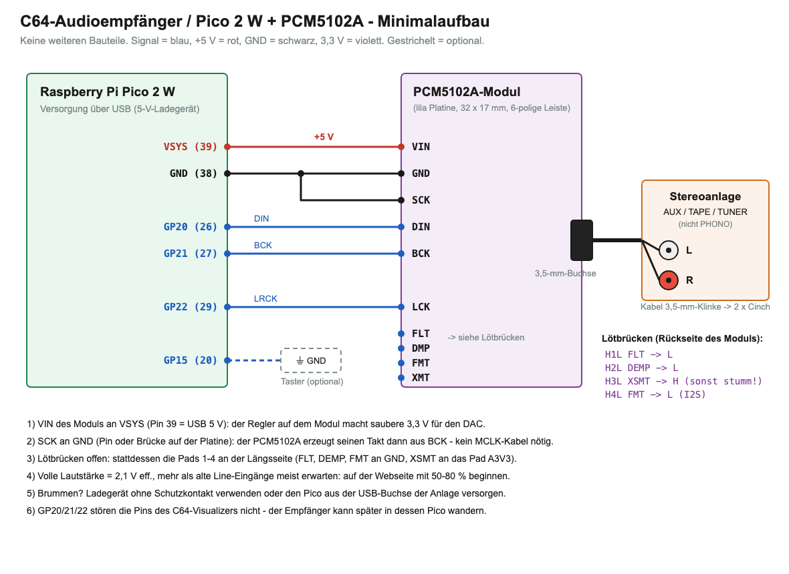

# C64-Audioempfänger – Pico 2 W + PCM5102A

*English version: [README.md](README.md)*

**Bedienungsanleitung:** [docs/HANDBUCH.md](docs/HANDBUCH.md) – Einrichtung, Anschluss, Weboberfläche, Weiterleitung,
Sicherung, Update, WLAN-Verhalten, Fehlersuche und Diagnosezeilen. Dasselbe Handbuch steht im Tab **Hilfe** der Weboberfläche.

Holt den **Audio-Stream eines Ultimate 64 (Elite II)** per WLAN und gibt ihn über ein **I2S-DAC-Modul PCM5102A**
an den Cinch-Eingängen einer Stereoanlage aus – echtes Stereo, 48 kHz, ohne Kabel vom C64 zur Anlage.
Gleichzeitig reicht er den Stream an den **C64-Visualizer** weiter (der Ultimate streamt nur an ein Ziel).

- **Jitter-Puffer** nach Sequenznummer (Ziel 80 ms, einstellbar 40–300 ms): Pakete in falscher Reihenfolge oder doppelt schaden nicht
- **Uhrenausgleich ohne Resampling:** der I2S-Takt selbst folgt dem Ultimate (PI-Regelung über den PIO-Teiler, gedithert) –
  der Ultimate läuft mit ~47 983 Hz statt 48 000 Hz
- **Aussetzer werden verdeckt statt zu knacken:** fehlende Pakete werden durch zeitlich gespiegelte Wiederholung des
  vorigen Pakets überbrückt (bis 12 ms, ausklingend), danach Stille mit sanftem Aus- und Einblenden
- **Weiterleitung** jedes Pakets unverändert an den Visualizer (abschaltbar, Ziel als IP oder Name, z. B. `c64viz.local`)
- **„Stream kommt weitergeleitet“**: Holt ein anderes Gerät (z. B. die Raspberry-Pi-Jukebox) den Stream und reicht ihn
  hierher weiter, fragt der Empfänger das Ultimate nie selbst – sonst nähme er ihm den Stream weg, sobald es dort hakt
- **Mehrere Ultimates** (bis 4) – Quelle auf der Webseite oder per Taster wählen; Netzwerksuche nach Ultimates
- **Geräte im Netz:** Meldung alle 10 s (UDP-Broadcast, Port 11064, dasselbe Format wie beim Visualizer); die Karte
  „Geräte im Netz“ zeigt alle Visualizer und Empfänger und den Weg des Tons
- **Einricht-Assistent des Visualizers:** öffnet diese Seite als `http://<ip>/#setup=<json>` mit Weiterleitung und
  Ultimate schon eingetragen (gelb umrandet, Hinweis oben); beim Speichern wird dieser Ultimate die Quelle und die
  Wiedergabe eingeschaltet
- **Weboberfläche (Deutsch)** mit Digest-Login: Start/Stopp, Quelle, Lautstärke, Puffer/Verluste/Taktabweichung live,
  WLAN- und Ultimate-Einstellungen, Sicherung der Einstellungen als Datei, Firmware-Update über WLAN, Diagnoseprotokoll,
  eingebautes Handbuch (Tab **Hilfe**: gzip-komprimiert im Flash, `GET /hilfe`, rund 11 KB, wird erst beim Öffnen des Tabs
  geladen; „? Hilfe zu diesem Tab“ in jedem anderen Tab springt zum passenden Abschnitt)
- Gerätename/mDNS wie beim Visualizer: **http://c64audio.local**

> **Anleitung für alle drei Geräte zusammen** (Visualizer, Audio-Empfänger, Raspberry-Pi-Jukebox – Einrichtung,
> Verkettung, Bedienung, Besonderheiten, mit Bildern): [docs/Anleitung_C64-Oekosystem.pdf](docs/Anleitung_C64-Oekosystem.pdf)

## Was geprüft wurde – und was nicht

| Geprüft | Noch nicht geprüft |
|---|---|
| Firmware baut für den Pico 2 W (Pico SDK 2.1.1) | **Klang, I2S-Timing und Pegel** – es stand noch kein PCM5102A zur Verfügung |
| Paketformat am echten Ultimate 64 Elite II gemessen (Sequenz little endian, 192 Frames, 47 982 Hz) | Prozessorlast des Timer-Interrupts |
| **Am echten Pico 2 W mit dem Elite II:** Empfang 250 Pakete/s ohne Verlust, Puffer 82–84 ms, Takt rastet bei 47 982,6–47 983,0 Hz ein; Weiterleitung an den Mac 7 997 Pakete in 32 s lückenlos und in Reihenfolge, an den Visualizer (`c64viz.local`, per mDNS aufgelöst) 250 Pakete/s, der Visualizer übernimmt sie ohne Lücke und fordert den Stream nicht zurück; Start fordert den Stream an, Stopp beendet ihn; Lautstärke speichern im Betrieb ohne Aussetzer; Firmware-Update über WLAN (393 KB in 4,6 s) | |
| Host-Tests: Jitter-Puffer Stück für Stück, die ganze Kette 4 × 10 min simuliert, Netzwerkteil mit Fakes; Weboberfläche im Browser (Playwright) | |

## Aufbau



| Pico 2 W | PCM5102A-Modul |
|---|---|
| VSYS (Pin 39) | VIN (5 V, das Modul hat einen eigenen 3,3-V-Regler) |
| GND (Pin 38) | GND **und SCK** |
| GP20 (Pin 26) | DIN |
| GP21 (Pin 27) | BCK |
| GP22 (Pin 29) | LCK |
| GP15 (Pin 20) – optional | Taster gegen GND |

**Das PCM5102A-Modul** (lila Platine 32 × 17 mm mit 3,5-mm-Buchse und 6-poliger Leiste SCK, BCK, DIN, LCK, GND, VIN, 3,3–5,5 V;
so bestellt: „AYWHP PCM5102 I2S … PHAT Format mit 3,5 mm Buchse“) hat auf der Rückseite vier Lötbrücken,
die oft **offen** geliefert werden – dann bleibt das Modul stumm:

| Brücke | Funktion | Stellung |
|---|---|---|
| H1L | FLT (Filter) | L |
| H2L | DEMP (De-Emphasis) | L |
| H3L | XSMT (Stummschaltung) | **H** (sonst stumm!) |
| H4L | FMT (Format) | L = I2S |

Sind die Brücken offen, gehen stattdessen die Pads 1–4 an der Längsseite (FLT, DEMP, XSMT, FMT): FLT, DEMP, FMT an GND, XSMT an das Pad A3V3.
**SCK an GND** (Pin oder die Brücke neben SCK auf der Vorderseite): der PCM5102A erzeugt seinen Takt dann aus BCK.

Andere Bauformen (z. B. die kleine 6-polige mit VIN/GND/LCK/DIN/BCK/SCK) werden genauso angeschlossen; hat das Modul
keinen eigenen Regler, VIN an **3V3 OUT (Pin 36)** statt VSYS.

**An die Anlage:** Kabel 3,5-mm-Klinke → 2 × Cinch an **AUX / TAPE / TUNER / CD** (nicht PHONO). Der PCM5102A liefert bei
voller Lautstärke 2,1 V eff. – mehr als alte Line-Eingänge meist erwarten. Auf der Webseite mit 50–80 % beginnen
(Standard 80 % ≈ −4 dB). Brummt es, ein Ladegerät ohne Schutzkontakt verwenden oder den Pico aus der USB-Buchse der Anlage versorgen.

Die Pins GP20/21/22 kollidieren nicht mit dem Visualizer (GP4/5, GP14–19, GP26/27) – der Empfänger kann später in dessen
Pico wandern.

## Gehäuse


`case/receiver_case.scad` – Unterteil und aufgesteckter Deckel wie beim Lichtsensor des Visualizers (Schürze über den
dünneren oberen Wänden, Rastwulst, Griffmulde), außen **64 × 57 × 35 mm**. Pico und PCM-Modul liegen nebeneinander, beide
Stiftleisten **nach unten**, darunter ein Kabelraum für die Dupont-Stecker (die Kabel machen dort ihren Bogen; 10-cm-Kabel
reichen). **USB-Buchse und Klinkenbuchse zeigen beide nach hinten.**

- Der Pico liegt hinten auf einer Leiste an der Rückwand und vorne auf zwei Stiften durch seine Befestigungslöcher;
  das Modul auf einer Leiste an der Rückwand und einer Rippe an seiner Vorderkante.
- Die Öffnung der Klinke ist im Unterteil nach oben offen, damit das Modul samt überstehender Buchse von oben eingesetzt
  werden kann; eine Zunge am Deckel schließt sie zum runden Loch. Stempel im Deckel halten beide Platinen nieder
  (auf den Pico-Löchern, auf der USB-Buchse und oben auf der Klinkenbuchse).
- Zusammenbau: erst die 6 Kabel aufstecken, dann Pico und Modul einlegen, Deckel aufdrücken.
- Drucken: `case/receiver_base.stl` aufrecht, `case/receiver_lid.stl` (schon umgedreht) mit der Oberseite nach unten,
  ohne Stützen. Vier Mulden im Boden für 8-mm-Gummifüße. STEP für Fusion: `case/step/` (`receiver_case_to_step.py`).
- **Die Maße des PCM-Moduls stammen aus der Händlerzeichnung** – nach Lieferung nachmessen und die mit (!) markierten Werte
  oben in `receiver_case.scad` anpassen (vor allem `jack_u`, `jack_d`, `jack_z`, `jack_over`), dann neu exportieren:
  `openscad -D 'part="base"' -o case/receiver_base.stl case/receiver_case.scad` (ebenso `lid`) und
  `../tools/cadquery-venv/bin/python case/receiver_case_to_step.py`.

## Firmware

| Datei | Wofür |
|---|---|
| `firmware/c64audio.uf2` | normale Firmware |
| `firmware/c64audio_debug.uf2` | zusätzlich Diagnose über USB-Seriell (`screen /dev/tty.usbmodem* 115200`) |
| `firmware/wlan_reset.uf2` | löscht WLAN-/Ultimate-/Passwort-Einstellungen (dieselbe Datei wie beim Visualizer) |

Aufspielen: BOOTSEL (oder den Taster an GP15) beim Einstecken halten und die .uf2 auf das Laufwerk kopieren – oder
`picotool load -f firmware/c64audio.uf2 && picotool reboot`. Später geht es über die Webseite (Reiter **System**).

Lief auf dem Pico vorher die Visualizer-Firmware, übernimmt der Empfänger deren WLAN, Webseiten-Passwort und Ultimate.

## Erste Schritte

1. Pico einstecken. Ohne Einstellungen öffnet er den Zugangspunkt **C64-Audio** (Passwort `commodore64`).
   Damit verbinden und **http://192.168.4.1** öffnen. Ist ein Heim-WLAN eingetragen, öffnet er den Zugangspunkt nur, wenn
   das WLAN-Passwort falsch ist oder drei Verbindungsversuche nichts bringen (WLAN nicht gefunden, keine Adresse vom
   Router); von dort versucht er es alle 5 Minuten erneut. War er seit dem Einschalten schon im Heim-WLAN, verbindet er
   nach einem Ausfall nur neu und öffnet keinen Zugangspunkt.
2. Unter **Einstellungen**: WLAN-Name und -Passwort, die Adresse des Ultimate (IP oder Name) und ggf. sein
   Netzwerk-Passwort – oder **„Netzwerk nach Ultimates durchsuchen“** und den Treffer mit **„übernehmen“** in den
   nächsten freien Platz holen. Die Suche fragt jede Adresse des Heimnetzes nach `/v1/info`, dauert gut eine Minute
   (der Ton kann dabei kurz aussetzen) und zeigt jedes Gerät einmal, mit seiner **Ethernet-Adresse** – die Ultimates
   streamen nur über Ethernet; ein nur per WLAN gefundenes Gerät wird rot markiert. Für den Visualizer **Weiterleitung** einschalten, Ziel `c64viz.local` (oder seine IP).
   Ein eigenes Passwort für die Webseite vergeben. Speichern – der Pico startet neu.
3. Im Heimnetz ist die Seite unter **http://c64audio.local** erreichbar (Benutzername beliebig, Passwort wie vergeben,
   ab Werk `commodore64`).
4. **Wiedergabe → Start**: der Pico bittet den Ultimate um den Stream (`PUT /v1/streams/audio:start?ip=<Pico>:11001`)
   und spielt, sobald 80 ms gepuffert sind.

**Taster (optional, GP15 gegen GND):** kurz = Start/Stopp, 1 s halten = nächster Ultimate, beim Einstecken halten = USB-Laufwerk.

**Sicherung (System → Sicherung):** „Sicherung herunterladen“ speichert alle Einstellungen als
`c64audio-<Name>-<Datum>.json` – WLAN, Webseiten-Passwort, Gerätename, Ultimate-Geräte, Weiterleitung, Puffer, Lautstärke
und Quelle. **Die Datei enthält Passwörter** (WLAN, Ultimate, Visualizer) – sicher aufbewahren. „Sicherung einspielen …“
fragt nach und schreibt sie zurück, danach startet der Pico neu (praktisch für einen zweiten Empfänger oder nach
`wlan_reset.uf2`). Der Pico prüft jeden Block vorher; eine beschädigte Datei oder eine Sicherung des Visualizers wird
abgelehnt und ändert nichts.

**LED auf dem Pico:** blinkt schnell = verbindet, Doppelblinken = eigener Zugangspunkt, kurzes Aufblitzen alle 2 s = bereit,
an = spielt.

## Zusammenspiel mit Visualizer und PC-Jukebox

Der Ultimate streamt **nur an ein Ziel**. Wer den Stream gerade hat, reicht ihn weiter:

- **Empfohlen:** Ultimate → **Audioempfänger** → Visualizer. Beim Visualizer bleibt „Audio-Stream vom Ultimate verwenden“
  an (Unicast); er fordert den Stream nur an, solange keine Pakete kommen – und es kommen ja welche vom Empfänger.
  Pakete, die vom Visualizer kommen, schickt der Empfänger nie zurück (keine Schleife).
- **Ultimate64 SID Jukebox am PC** (Spectrum Analyzer, „Play Audio Locally“, „Skip after silence“): sie holt sich den Stream
  und reicht ihn an *den* Pico weiter, der bei ihr eingetragen ist. Trägt man dort den **Audioempfänger** ein
  (`c64audio.local`), läuft die Kette Ultimate → PC → Empfänger → Visualizer. Die Titelmeldungen der Jukebox reicht der
  Empfänger ebenfalls an den Visualizer weiter (Laufschrift, Fortschritt, Mono/Stereo wie gewohnt). Ohne
  Visualizer-Passwort gehen sie mit dem Ton die Kette entlang (`C64NP1 <Abfrage>` an UDP-Port 11001; die
  Visualizer-Firmware ab 18.10.2026 nimmt sie ohne Passwort an) – Statusseite „Titel an den Visualizer: gesendet (ohne
  Passwort)“. Ist unter **Einstellungen → Weiterleitung** das **Passwort der Visualizer-Webseite** eingetragen, gehen sie
  mit Anmeldung an dessen Webseite (klappt auch mit älterer Visualizer-Firmware) – „übergeben“ bzw. „Passwort falsch“.
  Bleibt dort der Visualizer
  eingetragen, holt sich der Empfänger den Stream nach spätestens 10 s zurück – die PC-Funktionen bekommen dann keinen Ton mehr.
- Holt sich ein anderes Gerät den Stream immer wieder (zweimal in 2 Minuten), zeigt die Statusseite eine Warnung und der
  Empfänger fragt nur noch alle 60 s.

Der Empfänger nimmt Pakete von **einer** Quelle: kommen zwei Streams gleichzeitig (Ultimate direkt und weitergeleitet),
bleibt er bei der ersten, bis sie 0,2 s schweigt. „Stopp“ beendet den Stream am Ultimate nur, wenn er wirklich direkt an
den Empfänger geht.

## Statusseite – was die Zahlen bedeuten

| Anzeige | Bedeutung |
|---|---|
| Puffer | was gerade wartet (Ziel + 4 ms DAC-Warteschlange); der Balken zeigt es, der weiße Strich das Ziel |
| Takt / ppm | Ausgaberate; −17 ppm heißt: der Ultimate läuft 17 Millionstel langsamer als 47 983 Hz (nach ~1 min eingeregelt) |
| Verloren (überbrückt) | Paket fehlte, als es dran war – durch Wiederholung verdeckt |
| Zu spät gekommen | kam nach seiner Zeit, verworfen |
| Leergelaufen | der Puffer war leer (WLAN-Lücke länger als der Puffer) – ggf. Puffer vergrößern |
| Pakete verworfen (zu voll) | nach einem Stau zu viel im Puffer: auf das Ziel zurückgeschnitten |
| Neustarts | Sequenzsprung (neuer Stream, andere Quelle) |
| Fremde Quelle abgewiesen | Pakete eines zweiten Senders, während der erste lief |

## Bauen

```
export PICO_SDK_PATH=/pfad/zum/pico-sdk      # 2.1.1, mit Submodulen (lib/cyw43-driver, lib/lwip)
./build_all.sh                               # -> firmware/c64audio.uf2, c64audio_debug.uf2, wlan_reset.uf2
tests/run_host_tests.sh                      # Host-Tests (PC)
python3 tests/web/page_test.py               # Browsertest der Weboberfläche (Playwright + Chromium)
python3 tests/web/backup_test.py             # Browsertest der Sicherung
python3 tests/web/help.py                    # Browsertest des Tabs „Hilfe“ (Handbuch über echten HTTP-Server mit gzip)
python3 tests/web/eco.py                     # Browsertest der Karte „Geräte im Netz“
python3 tests/web/wizard.py                  # Browsertest der vom Einricht-Assistenten vorbereiteten Seite (#setup=)
```
Die Weboberfläche liegt in `tools/web/index.html`; `src/net/web_page.h` wird daraus erzeugt, `src/net/help_page.h` aus dem
Handbuch `docs/HANDBUCH.md` (`python3 tools/make_web_page.py`, macht `build_all.sh` selbst; das Skript prüft, dass alle Links
im Handbuch und alle `help('…')`-Links der Tabs ein Ziel haben). Schaltplan: `python3 docs/make_schematic.py`.

## Hinweise für die Nutzung

- **Nur fürs Heimnetz.** Die Weboberfläche läuft über HTTP ohne Verschlüsselung (das Passwort selbst geht dank
  Digest-Anmeldung nicht im Klartext übers Netz, alles andere schon). Audio-Stream und Titelmeldungen (UDP-Port 11001)
  sowie Gerätemeldungen (UDP 11064) kommen **ohne Anmeldung** an – jedes Gerät im selben Netz kann sie senden. Den
  Pico nicht aus dem Internet erreichbar machen (keine Portweiterleitung im Router) und nicht in fremden oder
  öffentlichen Netzen betreiben. Das Startpasswort `commodore64` gleich nach der Einrichtung ändern.
- **Auf eigene Gefahr.** Aufbau, Verkabelung und der Anschluss an Stereoanlage, Verstärker oder Kopfhörer geschehen
  auf eigenes Risiko – vor dem ersten Ton die Lautstärke niedrig stellen. Für Schäden an Geräten, Hardware oder Daten
  wird keine Haftung übernommen (siehe auch GPL-3.0, Abschnitte 15 und 16).
- **Retro-News:** Der Empfänger selbst zeigt keine Schlagzeilen. Die Retro-News der Raspberry-Pi-Jukebox (aus
  öffentlichen RSS-Feeds wie Indie Retro News, amiga-news.de, Commodore News, Cascade64, The Oasis BBS) laufen auf den Visualizern und lassen sich auf der Seite der Pi-Jukebox
  abschalten.
- Getestet ist nur mit der Hardware und dem Netz des Autors – siehe [Was geprüft wurde](#was-geprüft-wurde--und-was-nicht).

## Lizenz

Copyright (C) 2026 Sedor (der-sedor.de)

Dieses Programm ist freie Software: Es darf unter den Bedingungen der **GNU General Public License, Version 3**, wie
von der Free Software Foundation veröffentlicht, weitergegeben und verändert werden. Es wird in der Hoffnung
verbreitet, dass es nützlich ist, aber **ohne jede Gewährleistung** – sogar ohne die Gewährleistung der
Marktreife oder der Eignung für einen bestimmten Zweck. Der vollständige Lizenztext (englisch, maßgeblich) steht in
[`LICENSE`](LICENSE).

Fremdkomponenten (Pico SDK, lwIP, cyw43-driver, TinyUSB, der DHCP-Server aus MicroPython) und ihre Lizenzen: [`THIRD_PARTY_NOTICES.md`](THIRD_PARTY_NOTICES.md).

**Zusätzliche Erlaubnis nach Abschnitt 7 der GPL-3.0:** Den WLAN-Chip des Pico 2 W steuert der cyw43-driver, den
Raspberry Pi Ltd nur für die eigenen Chips lizenziert (siehe `THIRD_PARTY_NOTICES.md`) und der deshalb nicht
GPL-kompatibel ist. Die Firmware darf trotzdem weitergegeben werden – maßgeblich ist der englische Wortlaut in
[README.md](README.md#license):

> If you modify this program, or any covered work, by linking or combining it with the cyw43-driver (or a modified
> version of that library, including its WLAN chip firmware), containing parts covered by the terms of its Raspberry
> Pi licence, the licensors of this program grant you additional permission to convey the resulting work. The
> Corresponding Source of such a combination need not include the cyw43-driver; it is available from Raspberry Pi
> Ltd as part of the Raspberry Pi Pico SDK.

Webserver, Digest-Login, REST-Client, mDNS-Responder, Firmware-Update und Diagnose stammen aus dem C64-Visualizer
([c64-visualizer](https://github.com/sedorrr/c64-visualizer)).
